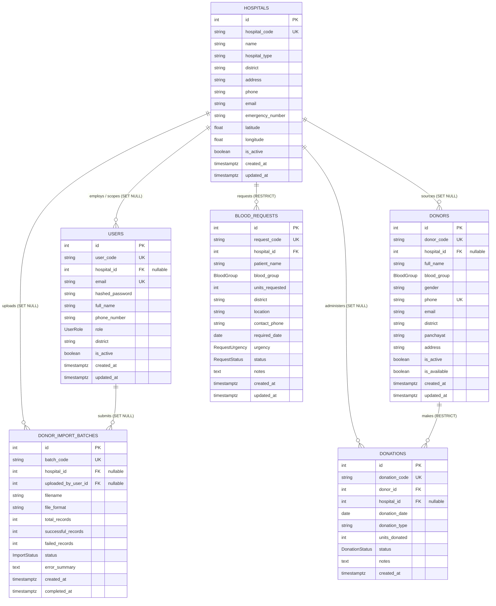

# Rakthasethu Database Design Specification (Final)

## 1. System Overview & Architecture Goals

Rakthasethu is a mission-critical Blood Donation Management and Donor-Matching Platform designed to connect hospitals, blood banks, administrators, and voluntary donors. The architecture is engineered around the following key principles:

1. **Relational Integrity & History Preservation:** Foreign keys and database constraints ensure data consistency across hospital uploads, donor profiles, donation histories, and clinical blood requests. Deletion of donor profiles is soft (`is_active = FALSE`) and foreign keys on historic ledgers use `ON DELETE RESTRICT` to guarantee that medical donation history cannot be accidentally purged.
2. **Deterministic Matching Support:** The schema provides indexed, structured attributes (ABO/Rh blood groups, geographical district, active and availability flags, and timestamped donation logs) for high-speed matching queries.
3. **Canonical Donor Identity:** Donors are globally centralized with normalized unique phone numbers. When multiple hospitals supply data for the same donor, the system merges details and appends donation records rather than creating fragmented duplicate profiles.
4. **Separation of Concerns:**
   - **Users:** Administrative and hospital staff accounts with role-based access control (RBAC).
   - **Hospitals:** Healthcare institutions that submit blood requests, sponsor donation camps, and upload batch donor datasets.
   - **Donors:** Central registry of voluntary blood donors (no dashboard user accounts required).
   - **Donations:** Immutable historical ledger of donation events linked directly to donors.
   - **Blood Requests:** Structured blood requirements initiated by hospitals for clinical patients.
   - **Donor Import Batches:** Audit trail and tracking ledger for hospital-initiated CSV/XLSX donor data uploads.

---

## 2. Controlled Enums & Types

The following PostgreSQL enumerations enforce database-level domain constraints:

### 2.1 `blood_group_enum`
- **Values:** `'A+'`, `'A-'`, `'B+'`, `'B-'`, `'AB+'`, `'AB-'`, `'O+'`, `'O-'`
- **Rationale:** Strict medical classification. Completely prevents invalid blood group strings.

### 2.2 `user_role_enum`
- **Values:** `'SUPER_ADMIN'`, `'HOSPITAL_ADMIN'`, `'STAFF'`
- **Rationale:** Manages RBAC permissions. `SUPER_ADMIN` has platform-wide access; `HOSPITAL_ADMIN` and `STAFF` are scoped to a specific `hospital_id`.

### 2.3 `donation_status_enum`
- **Values:** `'SCHEDULED'`, `'COMPLETED'`, `'CANCELLED'`, `'REJECTED'`
- **Rationale:** Tracks the operational lifecycle of blood donation sessions.

### 2.4 `request_status_enum`
- **Values:** `'PENDING'`, `'IN_PROGRESS'`, `'FULFILLED'`, `'CANCELLED'`, `'REJECTED'`
- **Rationale:** Manages the fulfillment pipeline for clinical blood requests.

### 2.5 `request_urgency_enum`
- **Values:** `'NORMAL'`, `'URGENT'`, `'CRITICAL'`
- **Rationale:** Prioritizes donor-matching queues and dispatch workflows.

### 2.6 `import_status_enum`
- **Values:** `'PENDING'`, `'PROCESSING'`, `'COMPLETED'`, `'FAILED'`
- **Rationale:** Tracks the status of asynchronous/batch hospital donor file uploads.

---

## 3. Entity Specifications

### 3.1 `hospitals` Table
Represents accredited healthcare centers, medical colleges, and blood banks.

| Column | Type | Nullable | Default | Constraints / References | Description |
| :--- | :--- | :--- | :--- | :--- | :--- |
| `id` | `INTEGER` | No | `SERIAL` | `PRIMARY KEY` | Unique internal hospital identifier |
| `hospital_code` | `VARCHAR(32)` | No | None | `UNIQUE`, `NOT NULL` | Human-readable code (e.g., `HOSP001`) |
| `name` | `VARCHAR(255)` | No | None | `NOT NULL` | Full official name of the hospital |
| `hospital_type` | `VARCHAR(50)` | No | `'Government'` | `NOT NULL` | Classification ('Government', 'Private') |
| `district` | `VARCHAR(100)` | No | None | `NOT NULL` | Administrative district (e.g., 'Kottayam') |
| `panchayat` | `VARCHAR(100)` | Yes | `NULL` | None | Local governing body / municipality |
| `address` | `TEXT` | No | None | `NOT NULL` | Physical location address |
| `phone` | `VARCHAR(20)` | Yes | `NULL` | None | General contact telephone number |
| `email` | `VARCHAR(120)` | Yes | `NULL` | None | Official communication email |
| `emergency_number` | `VARCHAR(20)` | Yes | `NULL` | None | 24/7 Blood bank / emergency helpline |
| `latitude` | `DOUBLE PRECISION` | Yes | `NULL` | None | Latitude coordinate for proximity calculation |
| `longitude` | `DOUBLE PRECISION` | Yes | `NULL` | None | Longitude coordinate for proximity calculation |
| `is_active` | `BOOLEAN` | No | `TRUE` | `NOT NULL` | Operational status flag |
| `created_at` | `TIMESTAMPTZ` | No | `CURRENT_TIMESTAMP` | `NOT NULL` | Record creation timestamp |
| `updated_at` | `TIMESTAMPTZ` | No | `CURRENT_TIMESTAMP` | `NOT NULL` | Record last updated timestamp |

* **Relationships:**
  - `users`: One-to-Many (Staff assigned to this facility)
  - `donors`: One-to-Many (Donors whose primary onboarding source was this facility)
  - `donations`: One-to-Many (Donation sessions collected at this facility)
  - `blood_requests`: One-to-Many (Requests initiated by this facility)
  - `import_batches`: One-to-Many (Batch upload audit records from this facility)

---

### 3.2 `users` Table
Administrative and hospital personnel who manage the system.

| Column | Type | Nullable | Default | Constraints / References | Description |
| :--- | :--- | :--- | :--- | :--- | :--- |
| `id` | `INTEGER` | No | `SERIAL` | `PRIMARY KEY` | Internal user ID |
| `user_code` | `VARCHAR(32)` | No | None | `UNIQUE`, `NOT NULL` | User identifier code (e.g., `USR001`) |
| `hospital_id` | `INTEGER` | Yes | `NULL` | `FK -> hospitals.id ON DELETE SET NULL` | Linked hospital (NULL for Super Admins) |
| `email` | `VARCHAR(120)` | No | None | `UNIQUE`, `NOT NULL` | Authentication login email |
| `hashed_password` | `VARCHAR(255)` | No | None | `NOT NULL` | Argon2 / bcrypt password hash |
| `full_name` | `VARCHAR(150)` | No | None | `NOT NULL` | User's full display name |
| `phone_number` | `VARCHAR(20)` | Yes | `NULL` | None | Contact phone number |
| `role` | `user_role_enum` | No | `'STAFF'` | `NOT NULL` | Role: `SUPER_ADMIN`, `HOSPITAL_ADMIN`, `STAFF` |
| `district` | `VARCHAR(100)` | Yes | `NULL` | None | Assigned district jurisdiction |
| `panchayat` | `VARCHAR(100)` | Yes | `NULL` | None | Assigned panchayat / ward |
| `is_active` | `BOOLEAN` | No | `TRUE` | `NOT NULL` | Account active flag |
| `last_login_at` | `TIMESTAMPTZ` | Yes | `NULL` | None | Timestamp of most recent authentication |
| `created_at` | `TIMESTAMPTZ` | No | `CURRENT_TIMESTAMP` | `NOT NULL` | Record creation timestamp |
| `updated_at` | `TIMESTAMPTZ` | No | `CURRENT_TIMESTAMP` | `NOT NULL` | Record last updated timestamp |

---

### 3.3 `donors` Table
Central registry of voluntary blood donors.

| Column | Type | Nullable | Default | Constraints / References | Description |
| :--- | :--- | :--- | :--- | :--- | :--- |
| `id` | `INTEGER` | No | `SERIAL` | `PRIMARY KEY` | Internal donor ID |
| `donor_code` | `VARCHAR(32)` | No | None | `UNIQUE`, `NOT NULL` | Public identifier (e.g., `DON001`) |
| `hospital_id` | `INTEGER` | Yes | `NULL` | `FK -> hospitals.id ON DELETE SET NULL` | Originating / primary onboarding hospital |
| `full_name` | `VARCHAR(150)` | No | None | `NOT NULL` | Donor's full legal name |
| `blood_group` | `blood_group_enum` | No | None | `NOT NULL` | Blood type (`A+`, `O-`, etc.) |
| `gender` | `VARCHAR(20)` | Yes | `NULL` | None | Gender identity (metadata) |
| `phone` | `VARCHAR(20)` | No | None | `UNIQUE`, `NOT NULL` | Normalized canonical contact phone (E.164 / 10-digit) |
| `email` | `VARCHAR(120)` | Yes | `NULL` | None | Optional contact email address |
| `district` | `VARCHAR(100)` | No | None | `NOT NULL` | Residence district (indexed for matching) |
| `panchayat` | `VARCHAR(100)` | Yes | `NULL` | None | Local village / town / municipality |
| `address` | `TEXT` | Yes | `NULL` | None | Full residential address |
| `is_active` | `BOOLEAN` | No | `TRUE` | `NOT NULL` | Record validity flag (soft-delete indicator) |
| `is_available` | `BOOLEAN` | No | `TRUE` | `NOT NULL` | Donor willingness flag (opt-in availability) |
| `created_at` | `TIMESTAMPTZ` | No | `CURRENT_TIMESTAMP` | `NOT NULL` | Registration timestamp |
| `updated_at` | `TIMESTAMPTZ` | No | `CURRENT_TIMESTAMP` | `NOT NULL` | Last update timestamp |

#### Distinct Meaning of `is_active` vs `is_available`:
* **`is_active`:** Controls whether the record is valid in the database. When set to `FALSE` (soft-delete), the donor is archived and completely omitted from all searches.
* **`is_available`:** Controls whether an active, valid donor is currently open to receiving blood donation inquiries. A donor might temporarily toggle `is_available = FALSE` (e.g. while traveling or unwell) without deactivating their account profile.

#### Deduplication & Multi-Hospital Policy:
* **Database Enforcement:** `phone` is strictly `UNIQUE`. Standardizing on normalized phone numbers guarantees that a citizen cannot be split into multiple duplicate identities.
* **Import Ingestion Handling:** When Hospital B uploads a dataset containing a phone number that was previously registered by Hospital A, the ingestion service performs an upsert: it updates the existing donor's latest address/contact details and records the new donation event linked to Hospital B without violating database constraints.

---

### 3.4 `donations` Table
Historical ledger of all scheduled, completed, cancelled, or rejected donation events.

| Column | Type | Nullable | Default | Constraints / References | Description |
| :--- | :--- | :--- | :--- | :--- | :--- |
| `id` | `INTEGER` | No | `SERIAL` | `PRIMARY KEY` | Unique transaction ID |
| `donation_code` | `VARCHAR(32)` | No | None | `UNIQUE`, `NOT NULL` | Ledger entry code (e.g., `DN001`) |
| `donor_id` | `INTEGER` | No | None | `FK -> donors.id ON DELETE RESTRICT` | Linked donor profile (**RESTRICT** prevents ledger destruction) |
| `hospital_id` | `INTEGER` | Yes | `NULL` | `FK -> hospitals.id ON DELETE SET NULL` | Collecting facility |
| `donation_date` | `DATE` | No | None | `NOT NULL` | Date when blood was donated |
| `donation_type` | `VARCHAR(50)` | No | `'Voluntary'` | `NOT NULL` | Category ('Voluntary', 'Replacement', 'Camp') |
| `units_donated` | `INTEGER` | No | `1` | `CHECK (units_donated > 0)` | Whole blood units collected |
| `status` | `donation_status_enum` | No | `'COMPLETED'` | `NOT NULL` | Status: `SCHEDULED`, `COMPLETED`, `CANCELLED`, `REJECTED` |
| `notes` | `TEXT` | Yes | `NULL` | None | Clinical remarks or deferral reasons |
| `created_at` | `TIMESTAMPTZ` | No | `CURRENT_TIMESTAMP` | `NOT NULL` | Record insertion timestamp |

* **Audit Preservation Guarantee:** `ON DELETE RESTRICT` prevents hard-deleting a donor who has associated donation history. Donors are deactivated (`is_active = FALSE`) instead.

---

### 3.5 `blood_requests` Table
Clinical patient blood requests initiated by hospitals.

| Column | Type | Nullable | Default | Constraints / References | Description |
| :--- | :--- | :--- | :--- | :--- | :--- |
| `id` | `INTEGER` | No | `SERIAL` | `PRIMARY KEY` | Unique request ID |
| `request_code` | `VARCHAR(32)` | No | None | `UNIQUE`, `NOT NULL` | Tracking code (e.g., `BR001`) |
| `hospital_id` | `INTEGER` | No | None | `FK -> hospitals.id ON DELETE RESTRICT` | Requesting hospital |
| `patient_name` | `VARCHAR(150)` | No | None | `NOT NULL` | Patient name or hospital clinical case ref |
| `blood_group` | `blood_group_enum` | No | None | `NOT NULL` | Required blood type |
| `units_requested` | `INTEGER` | No | `1` | `CHECK (units_requested > 0)` | Number of blood units required |
| `district` | `VARCHAR(100)` | No | None | `NOT NULL` | Fulfillment district |
| `location` | `VARCHAR(255)` | Yes | `NULL` | None | Ward / Room / specific department |
| `contact_phone` | `VARCHAR(20)` | No | None | `NOT NULL` | Primary emergency contact number |
| `emergency_contact` | `VARCHAR(20)` | Yes | `NULL` | None | Secondary contact telephone |
| `required_date` | `DATE` | No | None | `NOT NULL` | Date by which blood is required |
| `urgency` | `request_urgency_enum` | No | `'NORMAL'` | `NOT NULL` | Urgency: `NORMAL`, `URGENT`, `CRITICAL` |
| `status` | `request_status_enum` | No | `'PENDING'` | `NOT NULL` | Pipeline: `PENDING`, `IN_PROGRESS`, `FULFILLED`, `CANCELLED`, `REJECTED` |
| `notes` | `TEXT` | Yes | `NULL` | None | Clinical indications or special requirements |
| `created_at` | `TIMESTAMPTZ` | No | `CURRENT_TIMESTAMP` | `NOT NULL` | Request created timestamp |
| `updated_at` | `TIMESTAMPTZ` | No | `CURRENT_TIMESTAMP` | `NOT NULL` | Request status update timestamp |

---

### 3.6 `donor_import_batches` Table
Audit trail and progress tracker for hospital-uploaded CSV/XLSX donor datasets.

| Column | Type | Nullable | Default | Constraints / References | Description |
| :--- | :--- | :--- | :--- | :--- | :--- |
| `id` | `INTEGER` | No | `SERIAL` | `PRIMARY KEY` | Batch ID |
| `batch_code` | `VARCHAR(32)` | No | None | `UNIQUE`, `NOT NULL` | Public batch code (e.g., `IMP001`) |
| `hospital_id` | `INTEGER` | Yes | `NULL` | `FK -> hospitals.id ON DELETE SET NULL` | Hospital initiating the upload |
| `uploaded_by_user_id`| `INTEGER` | Yes | `NULL` | `FK -> users.id ON DELETE SET NULL` | Staff user who performed the upload |
| `filename` | `VARCHAR(255)` | No | None | `NOT NULL` | Original uploaded filename |
| `file_format` | `VARCHAR(10)` | No | `'csv'` | `NOT NULL` | Format ('csv', 'xlsx', 'xls') |
| `total_records` | `INTEGER` | No | `0` | `NOT NULL` | Total parsed rows |
| `successful_records`| `INTEGER` | No | `0` | `NOT NULL` | Successfully ingested/updated rows |
| `failed_records` | `INTEGER` | No | `0` | `NOT NULL` | Rows that failed validation |
| `status` | `import_status_enum` | No | `'PENDING'` | `NOT NULL` | Status: `PENDING`, `PROCESSING`, `COMPLETED`, `FAILED` |
| `error_summary` | `TEXT` | Yes | `NULL` | None | JSON or text summary of row errors |
| `created_at` | `TIMESTAMPTZ` | No | `CURRENT_TIMESTAMP` | `NOT NULL` | Upload initiation timestamp |
| `completed_at` | `TIMESTAMPTZ` | Yes | `NULL` | None | Batch completion timestamp |

---

## 4. Entity-Relationship Diagram



---

## 5. Cooldown & Matching Logic

* **No Hardcoded Cooldown Constraints:** Cooldown intervals (e.g. 90 days for whole blood, 14 days for apheresis platelets) remain in application configuration (`backend/app/core/config.py`).
* **Query Pattern for Matching Service:**
  ```sql
  -- Find eligible, available O+ donors in Kottayam whose last completed donation is >= 90 days ago (or never donated)
  SELECT d.id, d.donor_code, d.full_name, d.phone, d.blood_group, d.district,
         MAX(dn.donation_date) AS last_donation_date
  FROM donors d
  LEFT JOIN donations dn ON d.id = dn.donor_id AND dn.status = 'COMPLETED'
  WHERE d.is_active = TRUE
    AND d.is_available = TRUE
    AND d.blood_group = 'O+'
    AND d.district = 'Kottayam'
  GROUP BY d.id
  HAVING MAX(dn.donation_date) IS NULL 
      OR MAX(dn.donation_date) <= (CURRENT_DATE - INTERVAL '90 days');
  ```
