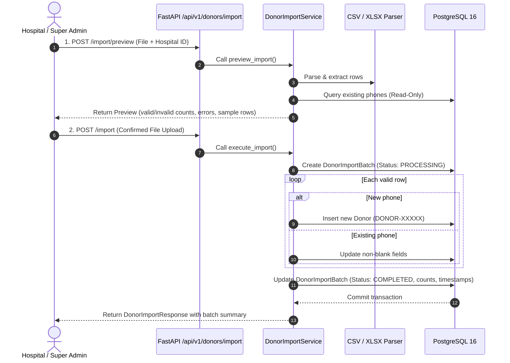

# Donor Bulk Import Specification (CSV / XLSX)

## 1. Overview
The Rakthasethu Donor Bulk Import feature allows hospital administrators and system super administrators to upload donor records in bulk using either **CSV** (`.csv`) or **Excel** (`.xlsx`, `.xlsm`) formats.

The import engine performs automatic file parsing, header normalization, cell type coercion, row-level validation, canonical E.164 phone normalization, deduplication against the central registry, and audit batch tracking.

---

## 2. Supported Formats & Limits

| Parameter | Specification | Config / Env Var |
|---|---|---|
| **Supported File Formats** | CSV (`.csv`), Excel (`.xlsx`, `.xlsm`) | Enforced by parser |
| **Character Encodings (CSV)** | UTF-8 with BOM (`utf-8-sig`), standard UTF-8, Latin-1 | Automatic fallback |
| **Max File Size** | 10 MB (default) | `MAX_IMPORT_FILE_SIZE_MB` |
| **Max Row Count** | 5,000 rows (default) | `MAX_IMPORT_ROWS` |
| **Database Transaction** | Atomic per import batch with rollback on fatal error | Service transaction |

---

## 3. Supported Columns & Aliases

The import parser normalizes column headers flexibly (ignoring case, spaces, and underscores).

| Field Name | Header Aliases Accepted | Type | Required? | Description / Validation Rules |
|---|---|---|---|---|
| `full_name` | `full_name`, `fullname`, `name`, `donor_name`, `donorname` | String | **Yes** | 1 to 150 characters. Whitespace is stripped. |
| `blood_group` | `blood_group`, `bloodgroup`, `blood`, `group`, `bg` | Enum | **Yes** | Must match valid ABO/Rh blood groups: `A+`, `A-`, `B+`, `B-`, `AB+`, `AB-`, `O+`, `O-` (also accepts `A POSITIVE`, `O NEGATIVE`, etc.). |
| `phone` | `phone`, `phonenumber`, `phone_number`, `mobile`, `mobile_number`, `contact`, `contact_number` | String / Numeric | **Yes** | Normalized to E.164 (`+91XXXXXXXXXX`). 10-digit Indian mobiles (e.g. `9847012345`), numbers with leading `0`, `91`, or `+91`. Numeric Excel cells are safely cast. |
| `district` | `district`, `city`, `location` | String | **Yes** | 1 to 100 characters. e.g. `Kottayam`, `Ernakulam`. |
| `email` | `email`, `email_id`, `emailaddress`, `mail` | String | Optional | Max 120 characters. Validated against standard email RFC format and converted to lowercase. |
| `gender` | `gender`, `sex` | String | Optional | Max 20 characters. e.g. `Male`, `Female`, `Other`. |
| `panchayat` | `panchayat`, `municipality`, `local_body`, `taluk` | String | Optional | Max 100 characters. |
| `address` | `address`, `residential_address` | Text | Optional | Full physical address. |
| `is_available` | `is_available`, `available`, `availability`, `status` | Boolean | Optional | Defaults to `true`. Accepts `true`/`false`, `1`/`0`, `yes`/`no`, `y`/`n`, `active`/`inactive`. |

### Restricted / Ignored Fields
The file parser strictly **ignores and forbids** passing:
- `id` / `donor_id`
- `donor_code`
- `donation_id`
- Internal timestamps (`created_at`, `updated_at`)

All database IDs and unique donor codes (`DONOR-00001`) are exclusively minted and managed by the backend engine.

---

## 4. Phone Normalization & Deduplication Strategy

### Phone as Canonical Identity
In Rakthasethu, a donor's primary unique identifier across hospitals and external imports is their **normalized E.164 phone number**.

### Deduplication & Update Rules
When processing each row:
1. **Phone Normalization**: The raw phone string is formatted to `+91XXXXXXXXXX`.
2. **Database Lookup**: The database is queried for an existing `donors` row matching the normalized phone.
3. **If Donor Does Not Exist (New Donor)**:
   - A new canonical `donor_code` (`DONOR-XXXXX`) is generated.
   - The donor record is inserted with `is_active=True`.
   - `new_donors_created` counter is incremented.
4. **If Donor Exists (Existing Donor)**:
   - The donor's original `donor_code` and `id` are strictly **preserved**.
   - Non-empty spreadsheet values update the existing profile (`full_name`, `email`, `gender`, `district`, `panchayat`, `address`, `is_available`).
   - **Non-destructive update**: Empty cells in the uploaded spreadsheet will **NEVER** overwrite existing stored data in the database with `NULL` or empty strings.
   - If the donor had no associated `hospital_id`, it is linked to the importing hospital.
   - `existing_donors_updated` counter is incremented.

---

## 5. End-to-End Import Workflow



---

## 6. Sample CSV

```csv
full_name,blood_group,phone,email,gender,district,panchayat,address,is_available
Arjun Menon,O+,9847012345,arjun@example.com,Male,Kottayam,Pala,Menon House,true
Lakshmi Nair,AB-,+91 9847098765,lakshmi@example.com,Female,Ernakulam,Aluva,Nair Villa,yes
Kiran Kumar,B+,09847011223,,Male,Thrissur,Chalakudy,,1
```
